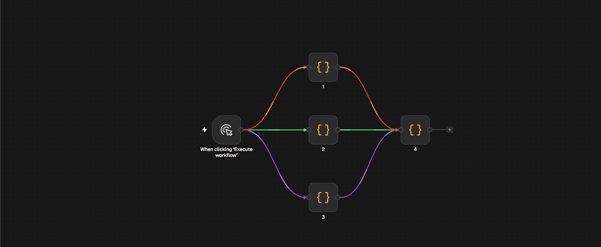
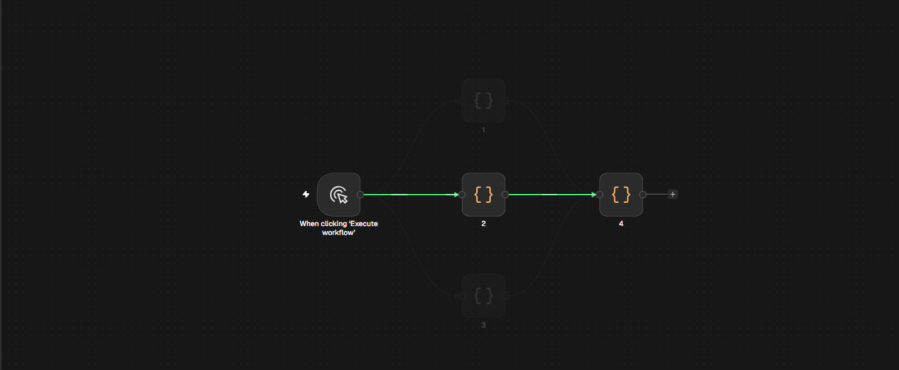

# Path Tracer for n8n

Расширение для n8n: строит все пути от триггера до выбранной ноды, красит ветки, а по клику на стрелку (связь) оставляет на экране только этот путь. Работает в n8n Cloud и на любом self-hosted инстансе.

Это неофициальное расширение: оно не связано с n8n, не одобрено и не спонсируется n8n.



На реальном n8n 2.46 (светлая тема, панель подхватывает токены n8n):



## Что умеет

- Трассировка **вверх** от выбранной ноды до всех триггеров/корневых нод.
- Несколько путей — разные цвета (HSL с золотым углом), соседние цвета не сливаются и на 12+ путях.
- Цвет закреплён за веткой: общий участок до развилки остаётся одного цвета, разные цвета появляются только на ответвлениях.
- Клик по ноде — пути показываются сразу, без меню и панелей.
- Клик по стрелке всегда изолирует её путь (клик по общей стрелке перебирает пути, проходящие через неё).
- Клик по пустому месту канваса или `Esc` — снять изоляцию; ещё один `Esc` — очистить трассировку.
- Кнопка с иконкой расширения в правом нижнем углу, оформленная как нативная панель управления n8n: показывает, что расширение активно; клик по ней (или `Alt+T`) выключает/включает трассировку.
- Остальные ноды и связи приглушаются, чтобы путь читался.
- Панорама и зум не требуют пересчёта: оверлей живёт в системе координат канваса n8n.
- SPA-навигация, смена воркфлоу, drag нод, циклы и несколько триггеров учтены.
- Никакой сборки и зависимостей: один ванильный JS-файл внутри расширения.

## Установка

Единственный способ — браузерное расширение. Оно само определяет n8n по мета-тегу `n8n:config:rest-endpoint` (и по канвасу), поэтому подходит для Cloud и любого self-hosted домена. На остальных сайтах скрипт сразу завершается и ничего не делает.

### Chrome / Edge / Brave / Arc

1. Возьмите папку `extension/` из репозитория (или `npm pack n8n-path-tracer-ui` и распакуйте архив).
2. Откройте `chrome://extensions` (Edge: `edge://extensions`) и включите «Режим разработчика».
3. «Загрузить распакованное расширение» → выберите папку `extension`.
4. Закрепите расширение на панели и откройте любой воркфлоу — справа снизу появится кнопка с иконкой расширения.

Обновление: замените файлы в папке и нажмите «Обновить» на карточке расширения.

Firefox: MV3 + `"world": "MAIN"` в content scripts поддерживается не всеми версиями и не тестировалось; используйте Chromium-браузер.

### n8n Cloud

Ничего дополнительно настраивать не нужно: Cloud-домен (`https://<ваш>.app.n8n.cloud`) покрыт расширением. CSP Cloud не мешает, потому что content script внедряется самим браузером в MAIN world, а не тегом `<script>` страницы. Это проверено тестом на странице со строгим `script-src 'nonce-...' 'strict-dynamic'`: страничные скрипты блокируются, расширение работает.

### Почему не через env-переменные

`EXTERNAL_FRONTEND_HOOKS_URLS` есть только на self-hosted, а в Cloud его задать нельзя. Расширение универсально: один и тот же пакет работает и там, и там, и не требует доступа к серверу.

## Использование

1. Откройте воркфлоу — справа снизу видна кнопка с иконкой расширения.
2. Кликните по ноде — сразу подсветятся все пути от триггера до неё.
3. Клик по стрелке — останется только этот путь. Клик по общей стрелке перебирает пути, проходящие через неё.
4. Клик по пустому месту канваса — снять изоляцию. `Esc` — снять изоляцию, ещё раз `Esc` — очистить трассировку.
5. `Alt+T` или клик по маркеру — выключить/включить трассировку.

## Как это работает

- Граф берётся из pinia-стора n8n (`workflowDocuments/*`: `allNodes`, `connectionsBySourceNode`), с фолбэком на разбор DOM (`.vue-flow__node[data-id]`, `.vue-flow__edge[data-id]`). Имена нод читаются из `data-node-name` (на узле или внутри него).
- Формат id связи n8n: `[<sourceId>/outputs/main/0][<targetId>/inputs/main/0]`; id резолвятся в имена нод через `data-id → data-node-name`.
- Учитываются только `main`-связи, то есть реальный поток исполнения: AI-подключения (`ai_languageModel`, `ai_tool`, `ai_memory` и т.п.) в путь не попадают.
- Пути ищутся DFS от целевой ноды вверх по входящим связям (защита от циклов, лимит 64 пути / 256 нод в пути).
- Оверлей — отдельный `<svg>` внутри `.vue-flow__transformationpane` (в n8n 2.46 каждая связь рендерится своим svg-слоем, поэтому общий слой ставится над ними и под ноды): копируются `d` нативных путей, поэтому панорама, зум и любая геометрия связей работают сами.
- Клики по связям определяются геометрически по координатам (расстояние до кривой), поэтому их не перехватывают слои канваса n8n.
- Геометрия оверлея синхронизируется с актуальными path-элементами n8n на каждом кадре: при перетаскивании ноды линии не отстают, анимация не перезапускается.
- Приглушение — атрибуты `data-pt-dim` / `data-pt-on` на нодах и связях плюс CSS, чтобы не конфликтовать с реактивными классами Vue.
- Плагин не меняет воркфлоу и не обращается к backend API — только читает состояние редактора на клиенте.

## Совместимость

Проверено 2026-11-01 на актуальных поддерживаемых линиях n8n:

| Линия | Версия | Итог |
| --- | --- | --- |
| v1 (security до 31.12.2026) | 1.123.91 | ✅ (DOM fallback) |
| 2.x (старейшая патчимая) | 2.41.7 | ✅ |
| stable | 2.45.7 | ✅ |
| beta | 2.46.3 | ✅ |
| v3 beta | 3.0.1 | ✅ |

Полная политика поддержки и методика — в [docs/compatibility.md](docs/compatibility.md). Перепроверка: `npm run compat -- 1.123.91 2.41.7 2.45.7 2.46.3 3.0.1`.

Ограничения: реальный Cloud-тенант не проверялся (редактор собирается из тех же пакетов, что и self-hosted); версии 1.0–1.122 и 2.0–2.40 вне текущей security-поддержки и не тестировались.

## Разработка и тесты

```powershell
cd path-trase
npm install
npm test          # 35 проверок плагина
npm run test:ext  # 11 проверок расширения под строгим CSP
```

`npm test` поднимает локальный HTTP-сервер, открывает `tests/mock.html` (макет канваса в стиле Vue Flow) и проверяет поиск путей, мгновенную трассировку по клику, отрисовку всех сегментов связи, изоляцию по стрелке (включая повторный клик), клик по пустому канвасу, `Esc`, чтение графа из pinia, маркер и выключение/включение трассировки.

`npm run test:ext` загружает расширение в Chromium, отдаёт страницу с `Content-Security-Policy: script-src 'nonce-...' 'strict-dynamic'` и проверяет, что страничные скрипты блокируются, а плагин из расширения работает; отдельно проверяется, что на не-n8n странице расширение ничего не делает. Для теста нужен Chromium/Edge (стабильный Google Chrome с 137-й версии игнорирует `--load-extension`; ручная установка через `chrome://extensions` при этом работает). Если браузер не найден, задайте `BROWSER_PATH`.

Перед раздачей расширения выполните `npm run build:ext`, чтобы `extension/path-tracer.js` совпадал с корневым файлом (тест расширения это проверяет).

Структура:

```
path-tracer.js              сам плагин (исходник)
extension/                  готовое расширение Chrome/Edge (manifest + копия плагина + иконки)
scripts/sync-extension.mjs  копирует path-tracer.js в extension/
tests/mock.html             макет канваса n8n
tests/run.mjs               e2e-тесты плагина
tests/run-extension.mjs     e2e-тесты расширения под строгим CSP
docs/                       лендинг для GitHub Pages + скриншоты, матрица совместимости, privacy.html
store/                      скриншоты 1280x800 для Chrome Web Store
CHROMEWEBSTORE.md           тексты листинга и обоснования для ревью
PRIVACY.md                  политика конфиденциальности
scripts/pack.ps1            сборка ZIP в dist/
scripts/compat.mjs          проверка совместимости с версиями n8n
```

## Прод-сборка и публикация

```powershell
npm install
npm test
npm run test:ext
npm run pack        # соберёт dist/path-tracer-for-n8n-<version>.zip
```

`npm run pack` синхронизирует `path-tracer.js` с папкой расширения и собирает ZIP для Chrome Web Store / Edge Add-ons. Готовые тексты листинга, обоснования широких `matches` и инструкция для ревьюера — в [CHROMEWEBSTORE.md](CHROMEWEBSTORE.md). Политика конфиденциальности — в [PRIVACY.md](PRIVACY.md) и [docs/privacy.html](docs/privacy.html), страницу нужно опубликовать по публичному URL и указать в листинге.

## Лендинг и GitHub Pages

Лендинг лежит в `docs/` (`index.html`, `styles.css`, `assets/`, `privacy.html`) и готов к публикации как статический сайт:

1. Запушьте репозиторий на GitHub.
2. Settings → Pages → Source: **Deploy from a branch** → branch `main`, folder **`/docs`**.
3. Сайт будет доступен по адресу `https://<user>.github.io/<repo>/`; `docs/privacy.html` — по `.../privacy.html` (можно указать в Chrome Web Store).

Все пути относительные, внешних зависимостей нет, `.nojekyll` уже добавлен. После публикации расширения замените плейсхолдер `https://chromewebstore.google.com/detail/path-tracer-for-n8n` на реальную ссылку магазина.

## Безопасность и приватность

- Нет сетевых запросов, телеметрии и хранения данных: плагин только читает DOM и стор редактора.
- Широкий `matches` нужен, чтобы работать с любым self-hosted доменом. На не-n8n страницах код выходит на первой проверке.
- Плагин исполняется в контексте страницы n8n и видит её DOM; это стандартное поведение расширений для редактирования UI.

## Лицензия

MIT — см. [LICENSE](LICENSE).
